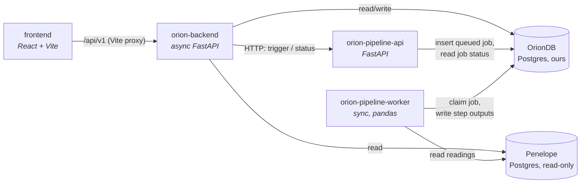
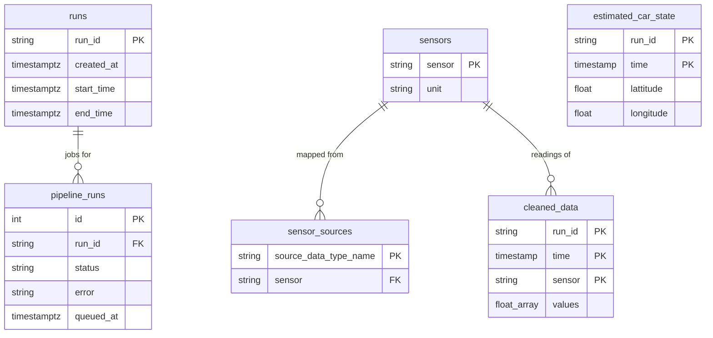
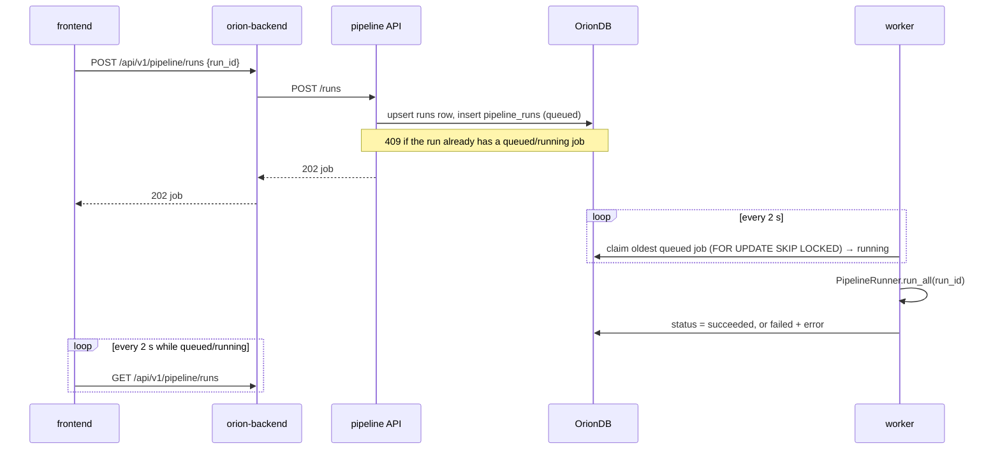
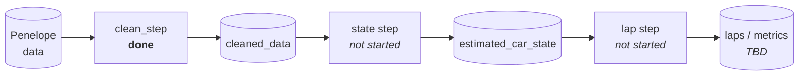

# Architecture

How Orion is put together today, why it is built that way, and what is still
missing. For setup, commands, configuration and per-folder layout, see
[DevREADME.md](../DevREADME.md).

Orion reads NER's raw telemetry from **Penelope**, processes each run through a
pipeline of steps, stores the results in its own database (**OrionDB**), and
serves them to a React dashboard.

---

## System overview



Five processes, plus a one-shot migration container, all defined in
`docker-compose.yml`:

| Process                 | Code                               | Role                                                         |
| ----------------------- | ---------------------------------- | ------------------------------------------------------------ |
| `frontend`              | `frontend/`                        | Runs list, pipeline trigger, run dashboard                   |
| `orion-backend`         | `services/backend/` (`orion_backend`) | The only API the browser talks to                         |
| `orion-pipeline-api`    | `services/pipeline/` (`orion_pipeline api`) | Queues pipeline jobs and reports their status       |
| `orion-pipeline-worker` | `services/pipeline/` (`orion_pipeline worker`) | Claims queued jobs and runs the pipeline steps   |
| `orion-db`              | `postgres:16-alpine`               | Local OrionDB (can be swapped for Neon via `ORION_DATABASE_URL`) |
| `orion-migrate`         | `packages/orion_core/alembic`      | `alembic upgrade head`, then exits                           |

All Python services share one package, `packages/orion_core`, which owns the
settings, every table definition, the Alembic migrations, and the SQL statement
builders. All three Python services are built from one image
(`docker/python.Dockerfile`), and Compose picks the command for each.

### Rules the design keeps

1. **Penelope is never written.** This is enforced three ways: a read-only DB
   role, `default_transaction_read_only=on` on every Penelope engine
   (`orion_core/db/engines.py`), and Penelope clients and repositories that have
   no write methods.
2. **The backend never runs pipeline code.** It reaches the pipeline only over
   HTTP (`PIPELINE_API_URL`), so a slow or crashing job can't take the API down.
3. **The pipeline API never does pipeline work.** It only inserts and reads
   rows in `pipeline_runs`. The worker is the only process that runs steps.
4. **One schema owner.** Only `orion_core` defines tables and migrations.
   Penelope's tables are declared on a separate `MetaData`, so Alembic can never
   touch them.
5. **Statement builders are shared, execution is not.** `orion_core/queries/`
   builds SQLAlchemy statements without running them. The async backend
   (asyncpg) and the sync pipeline (psycopg) both execute the same builders.

---

## Data model

### Penelope (source, read-only)

Declared by hand in `orion_core/models/penelope/penelope_tables.py`. The same
definitions work for the real Penelope (NER VPN) and `penelope2` (a Neon copy).

| Table       | Columns used                                    | Notes                                           |
| ----------- | ----------------------------------------------- | ----------------------------------------------- |
| `run`       | `id`, `time`                                    | `id` (uuid text) is Orion's `run_id`. `run."runId"` is a counter that is **not unique**, so Orion ignores it. |
| `data`      | `time`, `dataTypeName`, `runId`, `values[]`     | One row per reading. `runId` holds `run.id`. `values` is an unnamed float array (e.g. `[lat, lon]` for GPS). |
| `data_type` | `name`, `unit`                                  | Penelope's sensor list.                         |

### OrionDB (ours)



| Table                 | Written by                  | Purpose                                                          |
| --------------------- | --------------------------- | ---------------------------------------------------------------- |
| `runs`                | pipeline API (on enqueue)   | One row per Penelope run Orion has seen. The unit of work.       |
| `pipeline_runs`       | pipeline API, worker        | The job queue and the job history (`queued` → `running` → `succeeded` / `failed`). |
| `sensors`             | `seed_sensors` script       | Orion's clean sensor names and units (`unit` is NULL if unitless). |
| `sensor_sources`      | `seed_sensors` script       | Maps each Penelope `dataTypeName` (the `raw_tag`) to a `sensor`. |
| `cleaned_data`        | clean step                  | Readings renamed to clean sensor names, GPS time corrected.      |
| `estimated_car_state` | state step (not built yet)  | Estimated car state on a uniform time grid. Read by `GET /runs/{id}/state`. |

`sensors` and `sensor_sources` are seeded from `orion_core/db/sensor_catalog.py`,
which is the source of truth for the mapping. Edit the catalog and re-run
`python -m orion_core.db.scripts.seed_sensors` (it upserts; `--prune` deletes
rows no longer in the catalog). The clean step refuses to run if
`sensor_sources` is empty.

**Naming used everywhere:** `run_id` is a run's id (Penelope `run.id`, a string).
`raw_tag` is Penelope's name for a sensor (`TPU/GPS/Location`). `sensor` is
Orion's clean name for it (`gps_location`).

---

## Pipeline

### Job lifecycle



`pipeline_runs` doubles as the queue, so there is no Redis or Celery.
`SKIP LOCKED` means several workers could run side by side without claiming the
same job, though Compose runs one. The frontend polls job status every 2 seconds
while any job is active. When a job finishes it refetches the run lists, and on
success it also drops that run's cached data.

A run counts as **processed** when it has at least one `succeeded` job with no
error (`select_processed_run_ids`). Processed runs can be processed again.

The CLI also has `orion-pipeline run <run_id>` (`make pipeline-run RUN_ID=…`),
which runs the whole pipeline in the foreground and skips the queue. Use it for
debugging and backfills.

### Steps



A step is a `PipelineStep` subclass (`steps/base_step.py`) that declares:

| Attribute        | Meaning                                                       |
| ---------------- | ------------------------------------------------------------- |
| `name`           | Registry key                                                  |
| `depends_on`     | Names of steps that must run first                            |
| `reads_from`     | `"penelope"` or `"oriondb"`. The runner hands it the matching client |
| `output_table`   | OrionDB table it writes                                       |
| `pagination_key` | Columns its input is paged by. Together they must be unique   |

and implements `extract` (yield input pages) and `transform` (pure pandas, no
I/O). The base class runs it as:

```
prepare(ctx)        delete this run's rows in output_table
for page in extract(ctx):
    write(transform(page, ctx))     COPY into output_table
```

Steps register themselves with `@register_step` and are imported in
`steps/__init__.py`. `PipelineRunner.run_all` runs them in topological order of
`depends_on` (`graphlib.TopologicalSorter`). Each step gets a `RunContext`
(the `run_id` plus per-run config such as `gps_time_offset_s`) instead of a bare
id, so new per-run settings don't change every step's signature.

The design choices behind this:

- **Steps talk through tables, not DataFrames.** Each step writes its output to
  OrionDB and the next step reads it back. Any step can be re-run alone, and
  each intermediate result can be inspected with SQL.
- **Runs never have to fit in memory.** Input is read with keyset pagination
  (`BaseClient.iter_pages`), `PIPELINE_PAGE_SIZE` rows at a time (default
  100,000), each page on its own short connection. Keyset paging costs the same
  on every page, unlike `OFFSET`.
- **Re-runs replace, they don't duplicate.** `prepare` deletes the run's
  previous output before the first page is written.
- **Writes use Postgres `COPY`** (`OrionDBClient.append`), one transaction per
  page.
- **Steps never open sessions.** All DB access goes through
  `PenelopeClient` (read-only) or `OrionDBClient` (the only writer), which
  speak DataFrames.

### Clean step (`steps/clean_step/`)

Reads Penelope `data` for one run and writes `cleaned_data`.

1. `prepare` clears the run's `cleaned_data` and loads the `raw_tag → sensor`
   map from `sensor_sources`.
2. `extract` pages through the run's readings ordered by `(time, raw_tag)`,
   pulling **only tags in the map**. Unmapped tags never leave Penelope.
3. `transform` renames each `raw_tag` to its `sensor` (an unmapped tag at this
   point is treated as a bug and raises), and adds `GPS_TIME_OFFSET_S`
   (default 3 s) to `gps_location` timestamps, because GPS lags the other
   sensors.

Unit conversion, deduplication and outlier rejection are not done yet. Values
are stored in the units listed in the catalog.

### State estimation (planned)

Input: `cleaned_data`, where every sensor reports at its own irregular rate.
Output: `estimated_car_state`, the car's state on a uniform time grid (the target
is 100 Hz), one row per timestep. The table currently has only position
(`lattitude`, `longitude`). More state columns will be added as the estimator
produces them.

The chosen method is an Unscented Kalman Filter with Unscented RTS smoothing,
using a constant turn rate and acceleration motion model. Smoothing is possible
because runs are processed after the fact, so later readings can refine earlier
estimates. The reasoning is in
[sensor_fusion_method_selection_report.md](sensor_fusion_method_selection_report.md).
`steps/state_step/state_step.py` exists but is empty.

### Lap detection and metrics (planned)

The lap step will segment `estimated_car_state` into laps. Which per-lap
metrics to compute (lap time, speed, battery use, …) is still open and needs
input from NER. `steps/lap_step/lap_step.py` is empty. A draft `Metrics` model
exists in `orion_core/models/orion/metrics_model.py`, but it isn't registered
on `Base.metadata` or migrated, and it references a `lap_id` column that
`estimated_car_state` doesn't have yet. The frontend's `useMetrics` hook and
`metrics.schema.ts` assume `GET /runs/{run_id}/metrics` returns
`{run_id, laps: [{lap_id, start_time, end_time}]}`. That route doesn't exist yet.

---

## Backend (`services/backend`)

An async FastAPI app (SQLAlchemy async + asyncpg). Every route is under
`/api/v1` and documented at `/docs`. Each resource is split into layers:

```
route  →  service  →  repository  →  orion_core query builder
HTTP      rules,      runs the        builds the statement
only      domain      statement,
          errors      returns rows/None
```

- **Transactions:** `get_orion_db` commits once at the end of each request, and
  repositories only flush. Penelope sessions never commit.
- **Errors:** services raise domain exceptions (`core/exceptions.py`), and
  `core/exception_handlers.py` maps them to HTTP with one `ErrorResponse`
  shape: `NotFoundError` → 404, `ConflictError` → 409,
  `InvalidParameterError` → 422, `UpstreamError` → 502,
  `ServiceUnavailableError` → 503, any other `DomainError` → 400.
- **Penelope is optional and fallible.** If `PENELOPE_DATABASE_URL` is unset,
  Penelope-only routes return 503. If Penelope is unreachable (e.g. off VPN),
  they return 502. `GET /runs` uses Penelope only to add `run_time`, and gives
  up after 3 s, returning the list without it.

| Route                                   | Reads                         |
| --------------------------------------- | ----------------------------- |
| `GET /health`                           | none                          |
| `GET /runs[?processed=true]`            | OrionDB `runs` (+ Penelope `run.time`, best effort) |
| `GET /runs/{run_id}`, `DELETE /runs/{run_id}` | OrionDB `runs` (delete is refused while jobs reference the run) |
| `GET /penelope/runs`                    | Penelope `run`, each flagged `processed` from OrionDB |
| `GET /sensors`                          | Penelope `data_type`          |
| `GET /runs/{run_id}/sensors/data?sensors=&start=&end=` | Penelope `data` (raw, by `raw_tag`) |
| `GET /runs/{run_id}/state?start=&end=`  | OrionDB `estimated_car_state` |
| `POST /pipeline/runs`, `GET /pipeline/runs`, `GET /pipeline/runs/{id}` | forwarded to the pipeline API |

The time-series routes require `start` and `end`, so a single request can't pull
a whole run by accident. They don't downsample yet.

---

## Frontend (`frontend/`)

React 19 + TypeScript on Vite. TanStack Router (routes in code, in
`src/router.tsx`), TanStack Query for server state, Zustand for UI state, axios,
and zod. Every response is validated against a schema in `src/schemas/`, and
those schemas mirror the backend's Pydantic models.

| Route                    | View             | What it does                                               |
| ------------------------ | ---------------- | ---------------------------------------------------------- |
| `/runs`                  | `RunsView`       | Merges Penelope runs, OrionDB runs and pipeline jobs into one table with a status per run. Queues jobs. |
| `/runs/$runId/dashboard` | `DashboardView`  | Run header, plus a placeholder where charts, the track map and sensor panels will go. |

How the dashboard handles data:

- **The URL holds durable selection** (`?t=` time window, `?laps=`), so views
  can be linked and reloaded. **A per-run Zustand store holds transient
  interaction** (hover time, hover lap, a brush being dragged), and is recreated
  when the run changes.
- **Panels read data through `features/dashboard/data/useDashboardData.ts`**,
  choosing a scope (`overview` = whole run, `detail` = committed window) rather
  than passing time ranges. Panels asking for the same scope share one request
  and one cache entry.
- **Run data is cached as immutable.** It changes only when the run is
  reprocessed, and the pipeline hooks invalidate it explicitly then. So it has
  `staleTime: Infinity` and structural sharing is off, because time axes are
  parsed into `Float64Array`s that would be expensive to deep-compare.
- **No CORS:** the browser calls relative `/api/...` URLs and Vite proxies them
  to `API_PROXY_TARGET`.

---

## Known gaps

Things that are missing or behave in surprising ways in the current code:

- **Only the clean step exists.** State estimation, lap detection and metrics
  are not built. `PipelineRunner.run_step` and `run_from` raise
  `NotImplementedError`, so every job runs every step.
- **`runs.start_time` / `end_time` are never written.** The model and API docs
  say the clean step fills them, but it doesn't, so they stay `NULL` and
  `duration_s` is always `null`.
- **A crashed worker leaves its job `running` forever.** There's no heartbeat or
  timeout, so the run can't be queued again (409) until the row is fixed by hand.
- **Failed jobs leave partial output.** The old rows are deleted and each page is
  committed separately, so a job that fails midway leaves a partly written
  table until the run is processed again.
- **`pipeline_runs` only records `queued_at`.** There are no start or finish
  times and no per-step progress. Progress streaming (SSE) is a TODO.
- **Jobs are only created by hand.** The worker doesn't yet watch Penelope for
  new runs and queue them automatically.
- **No downsampling** on `/state` or `/sensors/data`. A whole-run request at
  100 Hz returns every row.
- **The column name is misspelled:** `estimated_car_state.lattitude`.
- **No tests yet.** `services/*/tests/` are empty, and CI runs lint, format,
  docstring and type checks only.
